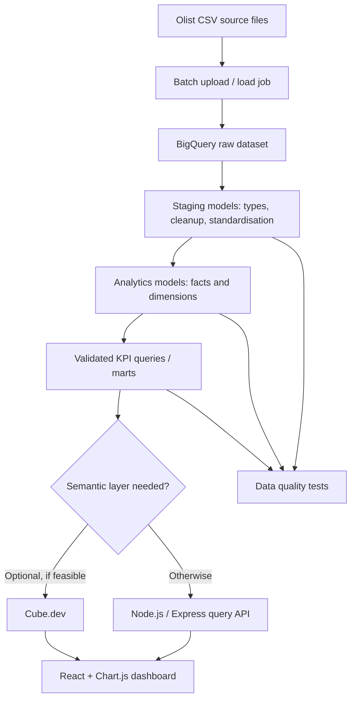

# 03 — Proposed Architecture

**Status:** Target design, not yet implemented.

## Logical flow

## Layers

### 1. Source

The Olist public dataset is composed of related CSVs. The original data period is historical, approximately 2016–2018. We will download only the files required for the first scope and add others when a business question requires them.

### 2. Raw

Purpose: preserve source columns as loaded so we can trace transformations back to the source. Table names should make their raw status obvious (for example, `raw_orders`). Load schemas and CSV options will be documented. The raw layer is not yet created.

### 3. Staging

Purpose: explicit data types, normalised dates/timestamps, whitespace/case checks, null profiles, and source-specific naming conventions. Preserve raw rows unless an exclusion rule has a documented reason.

### 4. Analytics models

Proposed initial model:

- `fct_order_items`: one row per source order-item record; product/seller/price/freight grain.
- `fct_orders`: one row per order; status and lifecycle timestamps.
- `fct_payments`: one row per source payment record (order may have multiple payments).
- `dim_customers`: one row per customer record, with customer identity and geography fields.
- `dim_products`: one row per product ID.
- `dim_sellers`: one row per seller ID.
- `fct_order_reviews` or an appropriately deduplicated review model, based on actual source grain.
- Translation dimension mapping source category names to English labels.

This is an initial hypothesis. We will adjust it after inspecting source schemas and keys. We should not force a one-table model if it creates fanout or double counting.

### 5. Metrics and presentation

Approved KPI SQL should be stored in `sql/04_business_analysis/` or `sql/03_data_marts/`. Dashboard values must come from validated SQL outputs and display the data period. A semantic layer via Cube.dev is optional; for the first version a simpler API or exported query outputs may be adequate.

## Deployment approach

- Learning/dev: BigQuery Sandbox and a local development environment where possible.
- Source control: Git repository containing SQL, docs, dashboard code, and screenshots—not credentials or default raw data copies.
- Optional integrations: add only after a minimal BigQuery-only workflow succeeds and costs/account requirements are checked.

## Known constraints

BigQuery Sandbox has no streaming, DML, or BigQuery Data Transfer Service; it has storage/query quotas and automatic expiry. Use official current documentation before making a deployment decision: https://cloud.google.com/bigquery/docs/sandbox

## Architecture decision criteria

Any additional tool must demonstrably improve ingestion reliability, semantic consistency, or dashboard access. If it creates a cost or account requirement that does not fit this project, document the reason and retain the simpler BigQuery-only path.
